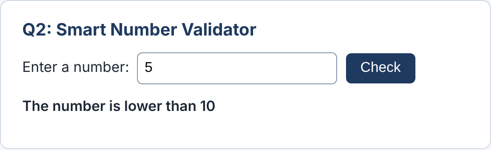
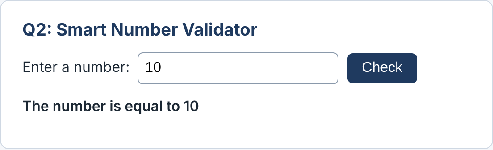
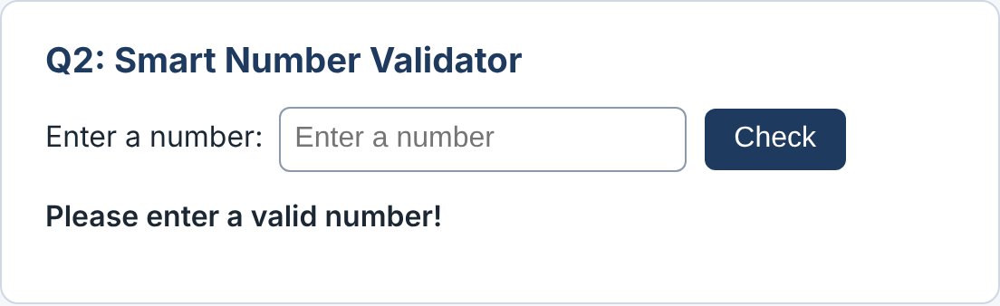
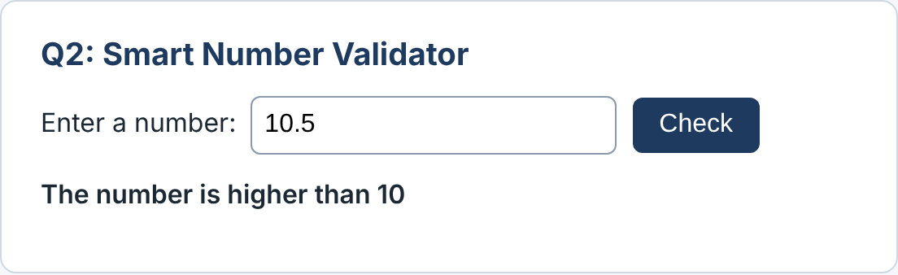
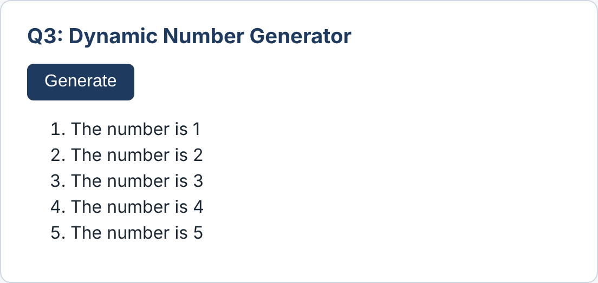

# BIC21203 Lab 4a - Client-Side Scripting (JavaScript)

**Name:** Abdelrahman Mohamed Abdeldin Osman
**Student ID (Matric No.):** BI30055
**Course:** BIC21203 Web Development, Semester 1, 2026/2027

## Description
Three small pages that use plain HTML5 and JavaScript (no external libraries). Each question is in its own folder with `index.html` and `script.js`. All events use `addEventListener()` and all output uses `textContent`.

| Folder | Task | Main concepts |
|--------|------|---------------|
| `q1/` | Interactive Text Changer | DOM selection, `changeMessage()`, click event |
| `q2/` | Smart Number Validator | `checkInput()`, `if...else if...else`, input validation |
| `q3/` | Dynamic Number Generator | `generateNumbers()`, `for` loop, `createElement()` |

## How to run
Open the `index.html` file inside each folder (`q1`, `q2`, `q3`) in a desktop browser. No server or installation is needed.

## Screenshots
### Q1 - Interactive Text Changer
| Before click | After click |
|---|---|
|  |  |

### Q2 - Smart Number Validator
| Input 5 | Input 10 | Input 15 |
|---|---|---|
|  |  |  |

| Input abc | Empty input | Input 10.5 | Spaces only |
|---|---|---|---|
|  |  |  |  |

### Q3 - Dynamic Number Generator
| Before | After 1 click | After 3 clicks (no duplicates) |
|---|---|---|
|  |  |  |
